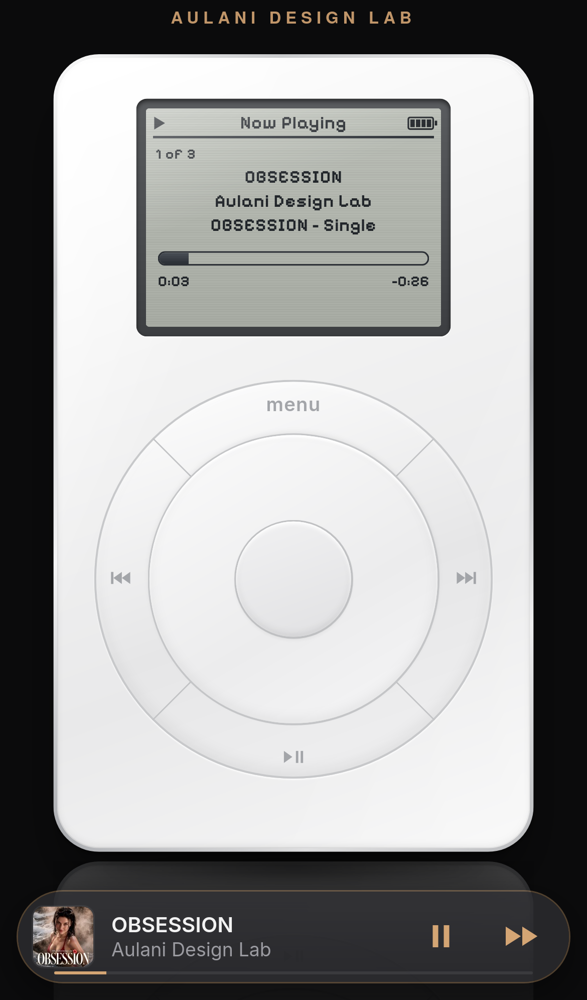

# Aulani Design Lab — iPod Web Player

A vintage **1st-gen iPod** music player for the web, with a click wheel, a pixel-font LCD and a Now Playing screen, built as original code from scratch. It comes loaded with the singles from [Aulani Design Lab](https://aulanidesign.com/), the progressive EDM label, and plays them through Apple's public 30-second previews.

**Live demo:** https://aulanidesign.com/ipod/ · **GitHub Pages:** https://thescroogle.github.io/aulani-ipod-player/



- It's a single static `index.html` with all the CSS, JS and the pixel font (Pixelify Sans, OFL) inlined. There's no build step and nothing to install.
- There are no cookies, no analytics and no third-party scripts.
- OBSESSION is cued when the page loads, and nothing plays until the visitor presses play.

## Run locally

`songs.json` is loaded with `fetch()`, so serve the folder over HTTP. Opening the file directly with `file://` won't work.

```sh
git clone https://github.com/thescroogle/aulani-ipod-player.git
cd aulani-ipod-player
python3 -m http.server 8000
# open http://localhost:8000/
```

`npx serve .` or any other static server works too.

## Embed it

Host the folder anywhere. All paths are relative. Then drop in an iframe:

```html
<div style="width:100%;max-width:420px;margin:0 auto;aspect-ratio:420/780">
  <iframe src="https://aulanidesign.com/ipod/" title="Aulani Design Lab iPod player"
          loading="lazy" allow="autoplay"
          style="display:block;width:100%;height:100%;border:0;background:#0B0B0C"></iframe>
</div>
```

The player scales itself to fit the box it's given. A 420:780 box fits the iPod, the top label and the mini player. Keep `allow="autoplay"` so the play press works inside the iframe on iOS. See `embed.html` for a copy you can paste.

## Use your own songs

Everything comes from `songs.json`. Edit it or replace it:

```json
{
  "schema": 2,
  "preload": { "song": "123", "context": "playlist:mine" },
  "theme": { "background": "#0B0B0C", "accent": "#D4A574", "label": "My Label", "title": "My Pod" },
  "playlists": [ { "id": "mine", "name": "My Playlist", "songIds": ["123"] } ],
  "artists":   [ { "id": "me", "name": "My Artist", "pinned": true, "songIds": ["123"] } ],
  "songs": [
    {
      "id": "123", "name": "Song Title", "artist": "My Artist", "album": "Album",
      "art": "https://…/cover-600x600.jpg",
      "preview": "https://…/30-second-preview.m4a",
      "src": null,
      "dur": 180000, "explicit": false, "genre": "House", "released": "2026-01-01",
      "appleMusic": "https://music.apple.com/…"
    }
  ]
}
```

- **`preview`** is a 30-second clip. The [iTunes Search API](https://performance-partners.apple.com/search-api) returns `previewUrl` and `artworkUrl100` for any track. Change `100x100` to `600x600` in the artwork URL for a sharper cover.
- **`src`** is optional. Set it to a full-length audio file you have the rights to, for example `"audio/song.m4a"`, and it plays instead of the preview. Files on another host need `Access-Control-Allow-Origin` so the volume and crossfade controls work. If `src` fails to load, the player falls back to `preview`.
- **`preload`** cues a track when the page loads. The context can be `playlist:<id>` or `artist:<id>`.
- **`theme`** sets the page background, the accent color and the label shown above the iPod.
- A track marked `"explicit": true` shows an **E** badge. The artist marked `pinned` is listed first under Artists.

## Controls

- Drag around the wheel to scroll. Faster drags scroll faster.
- Center selects. **Menu** goes back. **▶❙❙** plays or pauses. **|◀◀ / ▶▶|** skip, and holding them seeks.
- On Now Playing, the wheel sets the volume. Press center to scrub.
- Keyboard: arrow keys, Enter, Space and Esc. A mouse wheel or trackpad also scrolls.
- There's a hidden game: on Settings › About, hold center for 5 seconds.

## Network & privacy

The page loads only itself and `songs.json`, plus Apple's public CDNs for previews and cover art (`audio-ssl.itunes.apple.com`, `is1-ssl.mzstatic.com`). It calls `itunes.apple.com/search` only if someone uses Playlists › Search iTunes. Settings like volume, shuffle and backlight stay in the visitor's own `localStorage` under the key `pod:settings:v2`.

## Disclaimer

This is an **unofficial, fan-made tribute** to the original iPod. It is **not affiliated with, endorsed by or sponsored by Apple Inc.** iPod, iTunes and Apple Music are trademarks of Apple Inc. Music previews and artwork are served by Apple and remain the property of their respective rights holders.

## License

© 2026 Aulani Design Lab. **All rights reserved.** The source is published here to view and share. No open-source license is granted.
